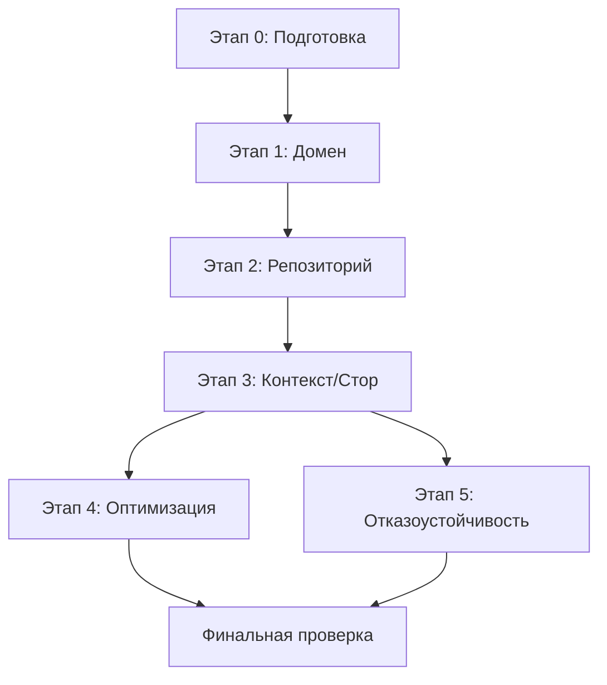

# План исправления архитектурных антипаттернов Track Meals

> Файл для будущего рефакторинга. На данный момент отложен, пока реализуются новые фичи.

## Цель
Устранить ключевые архитектурные проблемы: смешение слоёв, God-context, слабую отказоустойчивость, дублирование логики нормализации. Улучшить тестируемость, производительность и предсказуемость.

## Обзор изменений

### Принципиальные решения
- **Слоистая архитектура**: `domain/` (чистая бизнес-логика) ← `data/` (инфраструктура) ← `store/` (React-слой) ← `components/app/` (UI)
- **Репозиторий** вместо прямого импорта AsyncStorage из доменного кода
- **Разделённые контексты** для данных и действий (чтобы избежать лишних ререндеров)
- **Единая точка нормализации** - только в домене
- **Обработка ошибок персистентности** с обратной связью

---

## Этап 0. Подготовка (1-2 дня)
**Цель:** Зафиксировать текущее состояние, подготовить инфраструктуру под рефакторинг.

| Задача | Файлы | Детали | Критерий готовности |
|---|---|---|---|
| **0.1. Создать структуру директорий** | `src/domain/`, `src/data/`, `src/data/repositories/`, `src/data/services/`, `src/types/` | Подготовить новую структуру под слоистую архитектуру | Директории созданы |
| **0.2. Добавить типы ошибок персистентности** | `src/data/errors.ts` | Создать `StorageError`, `ParseError` для явной обработки | Типы определены |
| **0.3. Настроить базовое логирование** | `src/lib/logger.ts` | Логирование только в `__DEV__`, без утечки чувствительных данных | Утилита готова |
| **0.4. Сделать бэкап текущего состояния** | Git | Закоммитить текущее состояние в отдельную ветку `refactor/arch-cleanup` | Ветка создана, чистый коммит |

---

## Этап 1. Выделение доменного слоя (1-2 дня)
**Цель:** Сделать `lib/meals.ts` чистым от инфраструктуры.

| Задача | Файлы | Детали | Риски | Критерий готовности |
|---|---|---|---|---|
| **1.1. Перенести типы и константы в домен** | `src/domain/meals/types.ts`, `src/domain/meals/constants.ts` | Перенести `Meal`, `MealInput`, `MealType`, `MEAL_TYPES`, `MealsByDate`. Удалить импорты из инфраструктуры | Низкий | Все типы доступны из домена |
| **1.2. Централизовать нормализацию и валидацию** | `src/domain/meals/normalizers.ts` | Создать `normalizeMealInput()`, `normalizeMeal()`, `normalizeTime()`. Применять тримминг `name` везде. Вся логика округления/клиппинга только здесь | Низкий | Единая точка нормализации, тримминг имени в `sanitizeMeal` |
| **1.3. Перенести утилиты работы с блюдами** | `src/domain/meals/utils.ts` | Перенести `totalCalories()`, `totalLiquidMl()`, `hasLiquid()`, `mealTypeLabel()`, `isMealType()` | Низкий | Чистые функции без сайд-эффектов |
| **1.4. Создать ID-генератор** | `src/domain/meals/id.ts` | Вынести `createMealId()` (или использовать `crypto.randomUUID()` с фоллбэком) | Низкий | Отдельный модуль |
| **1.5. Рефакторить `lib/meals.ts`** | `src/lib/meals.ts` | Удалить `AsyncStorage`, оставить только реэкспорты для обратной совместимости, либо полностью удалить после миграции импортов | Низкий | `lib/meals.ts` больше не зависит от RN-инфраструктуры |

**Зависимости:** Этап 0 завершён.

---

## Этап 2. Репозиторий для персистентности (0.5-1 день)
**Цель:** Инверсия зависимости - домен не знает про AsyncStorage.

| Задача | Файлы | Детали | Риски | Критерий готовности |
|---|---|---|---|---|
| **2.1. Определить интерфейс репозитория** | `src/data/repositories/mealsRepository.ts` | Интерфейс `IMealsRepository { load(): Promise<MealsByDate>; save(data: MealsByDate): Promise<void> }` | Низкий | Чистый контракт |
| **2.2. Реализовать AsyncStorage-репозиторий** | `src/data/repositories/asyncStorageMealsRepository.ts` | Реализация с версионированием схемы (`STORAGE_KEY` можно вынести). Обработка ошибок с пробросом/логированием. Добавить миграции при несовпадении версии | **Средний** - нужно сохранить обратную совместимость с существующими данными | Корректно читает старый формат, сохраняет новый |
| **2.3. Сервис загрузки/сохранения** | `src/data/services/mealsStorageService.ts` | Обёртка над репозиторием: санитизация через доменный нормалайзер, обработка ошибок, логирование | Низкий | Инкапсулирует всю работу с хранилищем |
| **2.4. Фабрика/DI** | `src/data/di.ts` | Экспорт экземпляра репозитория по умолчанию для удобства (с возможностью замены на мок) | Низкий | Можно легко мокать в тестах |

**Важно:** При загрузке **обязательно** применять доменную нормализацию (включая тримминг имён). При сохранении можно сохранять уже нормализованные данные.

---

## Этап 3. Рефакторинг стора/контекста (1-2 дня)
**Цель:** Убрать God-context, исправить hydration, оптимизировать ререндеры.

| Задача | Файлы | Детали | Риски | Критерий готовности |
|---|---|---|---|---|
| **3.1. Разделить контексты** | `src/store/meals/context.tsx` | Создать `MealsDataContext` (только данные: `mealsByDate`, `isReady`, `hydrated`) и `MealsActionsContext` (только методы). Это позволит компонентам подписываться только на нужное | Средний - нужно обновить все `useMeals()` | Контексты разделены |
| **3.2. Исправить hydration** | `src/store/meals/provider.tsx` | Убрать `useRef` для `isReady`. Использовать `hydrated` флаг в стейте. Сохранять только после успешной гидратации. Обработать ошибки загрузки (показать fallback или пустое состояние с логом) | Низкий | Нет ref-хаков, предсказуемый жизненный цикл |
| **3.3. Перенести CRUD в провайдер** | `src/store/meals/provider.tsx` | Использовать репозиторий/сервис из этапа 2. Вся нормализация - через доменные функции. Убрать дублирование логики с `normalizeInput` | Низкий | CRUD идёт через доменный слой |
| **3.4. Добавить селекторы-хуки** | `src/store/meals/selectors.ts` | `useMealsForDate(dateKey)`, `useMealById(dateKey, id)`, `useMealCounts()`, `useDaySummary(dateKey)`. Мемоизация внутри хуков | Низкий | Компоненты могут подписываться точечно |
| **3.5. Обновить `useMeals()` для обратной совместимости** | `src/store/meals/index.ts` | Объединить данные+экшены через `useContext` обоих контекстов (или оставить как есть, но мигрировать постепенно) | Низкий | Существующий код работает, можно мигрировать по частям |
| **3.6. Обновить импорты во всём проекте** | `src/app/*`, `src/components/*` | Перейти на `@/store/meals` (уже есть) или на новые хуки-селекторы где уместно | Низкий | Все импорты консистентны |

**Целевой результат:** Компоненты типа `Calendar` могут использовать `useMealCounts()` вместо подписки на весь `mealsByDate`.

---

## Этап 4. Оптимизация производительности и консистентность (0.5-1 день)
**Цель:** Исправить мелкие, но важные проблемы.

| Задача | Файлы | Детали | Риски | Критерий готовности |
|---|---|---|---|---|
| **4.1. Исправить работу с Date** | `src/lib/date.ts` | В `getMonthGrid` не мутировать `gridStart` напрямую (создавать копии). В `index.tsx` использовать `fromDateKey` вместо конструирования из строки `YYYY-MM-DDT00:00:00` где возможно | Низкий | Чистые функции, меньше TZ-зависимости |
| **4.2. Оптимизировать пересчёты** | `src/app/index.tsx` | `mealCounts` можно вынести в селектор `useMealCounts()` с мемоизацией. Снизить кол-во `StyleSheet.flatten` | Низкий | Меньше лишних пересчётов |
| **4.3. Унифицировать удаление пустых дней** | `src/domain/meals/utils.ts`, `src/store/meals/provider.tsx` | Вынести стратегию в одно место. Либо всегда удалять ключ при пустом массиве, либо всегда оставлять. Выбрать одно поведение и задокументировать | Низкий | Единообразная логика |
| **4.4. Улучшить MealForm** | `src/components/MealForm.tsx` | Убрать дублирование нормализации (она будет в сторе). Форма только собирает значения, валидация минимальная. Можно добавить базовую маску для времени, но основная валидация - в домене | Низкий | Меньше дублирования, тоньше компонент |
| **4.5. Удалить мёртвый код** | `src/app/day/[date].tsx` | Удалить неиспользуемый `export function SuspenseFallback` если действительно не нужен | Низкий | Чистый код |

---

## Этап 5. Отказоустойчивость персистентности и UX (0.5 дня)
**Цель:** Не терять данные молча.

| Задача | Файлы | Детали | Риски | Критерий готовности |
|---|---|---|---|---|
| **5.1. Обработка ошибок загрузки** | `src/store/meals/provider.tsx` | При ошибке загрузки - логировать, можно показать `ErrorFallback` с возможностью "Попробовать снова" или просто пустое состояние с уведомлением | Низкий | Пользователь видит проблему, а не пустой календарь без объяснения |
| **5.2. Обработка ошибок сохранения** | `src/store/meals/provider.tsx`, `src/data/services/mealsStorageService.ts` | Сохранять в фоне с обработкой ошибок. В dev-режиме можно алертить, в проде - тихий лог + возможно очередь ретраев | Низкий | Ошибки не глотаются бесследно |
| **5.3. Версионирование схемы** | `src/data/repositories/asyncStorageMealsRepository.ts` | Хранить `{ version: 1, data: MealsByDate }`. При чтении мигрировать со старого формата (просто массив/объект) на новый | **Средний** - нужно тестировать с реальным форматом из хранилища | Обратная совместимость сохранена |
| **5.4. Добавить защиту от переполнения** | `src/data/repositories/asyncStorageMealsRepository.ts` | При ошибке сохранения (quota exceeded) - логировать с размером данных | Низкий | Лучше диагностика |

---

## Порядок выполнения и зависимости

**Рекомендуемый порядок:** 0 → 1 → 2 → 3 → (4 и 5 параллельно) → проверка

---

## Стратегия миграции

### Поэтапная миграция импортов
1. **Шаг 1:** Создать новые модули, оставить старые как реэкспорты (`export * from '@/domain/meals/types'` в `lib/meals.ts`)
2. **Шаг 2:** Мигрировать импорты по одному файлу/модулю, проверяя `tsc --noEmit`
3. **Шаг 3:** После полной миграции удалить старые реэкспорты

### Feature flag (опционально)
Если хочется максимально безопасно - можно завести флаг в провайдере для переключения между старым и новым стором, но для такого проекта избыточно.

---

## Проверка и тестирование

| Проверка | Команда/способ | Критерий успеха |
|---|---|---|
| **Типизация** | `npx tsc --noEmit` | 0 ошибок |
| **Линтинг** | `npx expo lint` | 0 ошибок/варнингов (или только приемлемые) |
| **Базовый функционал** | Ручное тестирование в Expo Go/dev build | Календарь загружается, добавление/редактирование/удаление работает, данные сохраняются после перезапуска |
| **Персистентность** | Добавить приём пищи → закрыть приложение → открыть → данные на месте | Данные сохранены |
| **Гидратация** | Проверить отсутствие мерцания/записи пустого состояния до загрузки | Нет перезаписи старыми данными |
| **Производительность** | Быстро переключать месяцы в календаре, добавлять много приёмов | Нет заметных лагов, ререндеры минимальны |
| **Обратная совместимость** | Установить билд со старыми данными в AsyncStorage | Старые данные корректно загрузятся и мигрируют |

---

## Риски и митигация

| Риск | Вероятность | Влияние | Митигация |
|---|---|---|---|
| **Потеря данных при миграции репозитория** | Средняя | Критичное | Тестировать на копии AsyncStorage. Сохранять бэкап через `AsyncStorage.getItem` перед миграцией. Добавить логирование чтения/записи |
| **Регрессии в UI из-за изменения стора** | Средняя | Высокое | Мигрировать поэтапно, использовать обратную совместимость `useMeals()`, проверять каждый экран после изменений |
| **Проблемы с типизацией при реэкспортах** | Низкая | Среднее | Держать `tsc --noEmit` зелёным на каждом коммите этапа |
| **Сложность с Date/TZ** | Низкая | Среднее | Сохранить текущую логику `toDateKey`/`fromDateKey` (работает в локальном времени), просто убрать мутации |

---

## Оценка трудозатрат

| Этап | Время | Сложность |
|---|---|---|
| Этап 0 | 0.5 дня | Низкая |
| Этап 1 | 1-1.5 дня | Низкая-Средняя |
| Этап 2 | 0.5-1 день | Средняя |
| Этап 3 | 1-1.5 дня | Средняя-Высокая |
| Этап 4 | 0.5 дня | Низкая |
| Этап 5 | 0.5 дня | Низкая |
| **Итого** | **4-6 дней** | **Средняя** |

---

## Рекомендуемый минимальный набор для старта

Если нужно быстро закрыть самые критичные проблемы - **минимум: Этап 1 + Этап 2 + части Этапа 3 + Этап 5**.

Критично в первую очередь:
1. **Выделить домен** (убрать AsyncStorage из `lib/meals.ts`) - решает смешение слоёв
2. **Сделать репозиторий** - решает тестируемость и связанность
3. **Исправить hydration без ref** - убирает хрупкость
4. **Не глотать ошибки сохранения** - предотвращает потерю данных

Всё остальное можно делать итеративно без риска поломки всего приложения.
